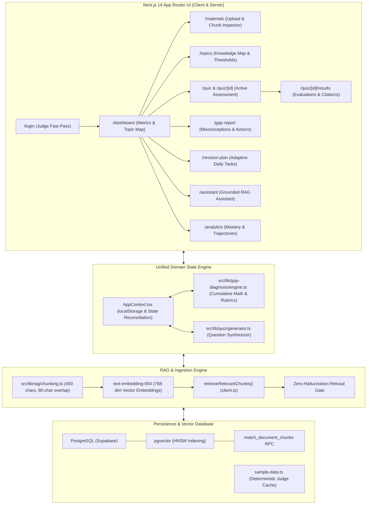

# 🚀 GapFinder AI — Personalized Learning Gap Detection System

> **GapFinder AI** is an AI-powered diagnostic learning system that identifies what students do **not** understand from their own study materials. It proactively probes knowledge boundaries, evaluates answers deterministically and via AI rubrics, isolates weak concepts, and generates an adaptive, day-by-day revision schedule.

[](https://nextjs.org/)
[](https://www.typescriptlang.org/)
[](https://tailwindcss.com/)
[](https://supabase.com/)
[](https://deepmind.google/technologies/gemini/)

---

## 📑 Table of Contents
1. [Problem Statement & Why GapFinder AI Stands Out](#-problem-statement--why-gapfinder-ai-stands-out)
2. [Hackathon Judge Fast-Pass Instructions](#-hackathon-judge-fast-pass-instructions)
3. [System Architecture Diagram](#-system-architecture-diagram)
4. [RAG Pipeline Deep Dive](#-rag-pipeline-deep-dive)
5. [Strict Separation of Retrieval vs. Generation (6 AI Features)](#-strict-separation-of-retrieval-vs-generation)
6. [Mathematical Diagnosis Model](#-mathematical-diagnosis-model)
7. [Local Setup & Quickstart](#-local-setup--quickstart)
8. [System Limitations & Future Scalability](#-system-limitations--future-scalability)

---

## 🎯 Problem Statement & Why GapFinder AI Stands Out

### The Fatal Flaw of Generic "Chat with PDF" Bots
Standard AI study tools act as passive conversational chatbots. When students use chat-with-document apps:
- **The Illusion of Competence:** Reading an AI summary triggers recognition, not active recall.
- **Passive Questioning:** Students cannot ask questions about topics they do not realize they misunderstand (*"You don't know what you don't know"*).
- **Zero Gap Isolation:** General chatbots never track which specific mathematical lemmas, formula assumptions, or architectural layers a student routinely misapplies.

### The GapFinder AI Paradigm Shift
GapFinder AI reverses the educational dynamic by initiating **proactive diagnostic discovery**:

```
[Standard AI Chatbot]   ─── Student asks question ───> Bot summarizes ───> 0 Gap Discovery
[GapFinder AI]          ─── Bot diagnoses mastery ───> Student answers ───> Isolates Exact Gaps
```

1. **Diagnosis Before Questions:** Proactively generates diagnostic assessments directly grounded in uploaded lecture notes and course readers.
2. **Deterministic & Rubric-Grounded Evaluation:** Multiple Choice Questions (MCQs) are scored deterministically; conceptual short-answers are evaluated against grounded multi-point rubrics (0–100%).
3. **Strict Assessment Security:** Answers, rubric scoring keys, and citations remain **strictly hidden** during active testing (`/quiz/[id]`) and are only revealed upon submission.
4. **Statistical Confidence Guard:** Prevents false classifications. Requires a minimum of 3 answered questions before labeling a student "Weak" or "Strong".
5. **Adaptive Revision Planning:** Maps diagnostic deficits into a calendarized study plan prioritizing critical gaps on Day 1.

---

## 🏆 Hackathon Judge Fast-Pass Instructions

GapFinder AI comes **preloaded with a complete, authentic Deep Learning curriculum** (CS-682 Course Reader & Specialized Module Notes). Evaluators can review 100% of features immediately with **zero configuration and zero API keys required**.

### 1. Fast-Pass 1-Click Login
1. Navigate to `/login` (or [http://localhost:3000/login](http://localhost:3000/login)).
2. Click the prominent **"1-Click Judge Demo Login"** button.
3. You will immediately enter `/dashboard` as `Dr. Alex Rivera (Hackathon Judge)`.

### 2. Documented Demo Credentials
For evaluators who prefer entering credentials manually:
- **Email:** `judge@gapfinder.ai`
- **Password:** `GapFinderJudge2026!`

### 3. Preloaded Curriculum Baseline (`sample-data.ts`)
| Topic | Baseline Score | Questions Attempted | Initial Status | Diagnostic Rationale |
| :--- | :---: | :---: | :---: | :--- |
| **Artificial Neural Networks (ANN)** | **90%** | 10 | `strong` | Backpropagation & chain rule mastered |
| **Convolutional Neural Networks (CNN)** | **40%** | 8 | `weak` | **Critical Gap:** Confuses Valid vs Same padding & Max-Pooling gradients |
| **Recurrent Neural Networks (RNN)** | **65%** | 6 | `medium` | Developing understanding of LSTM cell state & BPTT |
| **Transformers & Self-Attention** | **80%** | 8 | `strong` | Robust accuracy on Scaled Dot-Product & QKV matrix math |
| **Autoencoders & Latent Space** | **N/A (0%)** | 1 | `insufficient_data` | **Confidence Guard Triggered:** Only 1 attempt (< 3 questions required) |

### 4. 1-Click Demo Reset
At any point during evaluation, click the **"Reset Demo Data"** button in the sidebar footer to cleanly purge `localStorage` overrides and restore the baseline dataset.

---

## 🏗️ System Architecture Diagram



---

## 🔄 RAG Pipeline Deep Dive

Every uploaded document transitions through a strict, multi-stage pipeline:

```
[Uploaded PDF / Text Document (Max 10MB)]
                   │
                   ▼
[1. Text Extraction & Structural Normalization]
                   │
                   ▼
[2. Sliding-Window Semantic Chunking (chunking.ts)]
    • Chunk Size: ~450-500 characters
    • Overlap: 80 characters (sliding window)
    • Page Transition Estimation: ~1,800 chars / page
    • Regex Header Detection: `^(Chapter|Section|Module)\s+\d+`
                   │
                   ▼
[3. Chunk Metadata Contract (types.ts)]
    {
      id: "chunk-cnn-01",
      documentId: "doc-cnn-deepdive",
      chunkIndex: 1,
      content: "Section 2.1: Mathematical Formulation...",
      metadata: {
        pageNumber: 14,
        sectionTitle: "Section 2.1: Spatial Dimension Formula",
        sourceDocument: "Module_2_CNN_Math_And_Receptive_Fields.pdf",
        topicTag: "topic-cnn"
      }
    }
                   │
                   ▼
[4. 768-Dimensional Vector Embeddings]
    • Model: Google text-embedding-004
    • Distance Metric: Cosine Distance (<=>)
                   │
                   ▼
[5. Vector Indexing & Semantic Search]
    • Storage: Supabase PostgreSQL pgvector
    • Indexing: Hierarchical Navigable Small World (HNSW)
    • Retrieval RPC: match_document_chunks(query_embedding, match_threshold, match_count)
                   │
                   ▼
[6. Context-Grounded Synthesis & Verification]
    • Questions, evaluations, and explanations cite exact page & section
```

---

## 🛡️ Strict Separation of Retrieval vs. Generation

GapFinder AI strictly separates **Step A (Retrieval)** from **Step B (Generation)** across all 6 core AI capabilities:

| # | Feature Route | Step A: Retrieval Phase | Step B: Generation Phase | Verification & Citation Guarantee |
|---|---|---|---|---|
| **1** | **Document Ingestion** (`/materials`) | Text parsed and partitioned via `chunkTextWithMetadata()` in [`chunking.ts`](src/lib/rag/chunking.ts) with 80-char overlap. | None. Ingestion is pure extraction and structural indexing. | Chunks inspected live in the Chunk Inspector with page numbers and character counts. |
| **2** | **Vector Retrieval** (`/materials`, `/assistant`) | `match_document_chunks` RPC in Supabase pgvector or `retrieveRelevantChunks()` in [`client.ts`](src/lib/gemini/client.ts). | Filtered chunks injected into LLM system context. Outside memory forbidden. | Retrieves top $K$ semantic matches with verified cosine similarity. |
| **3** | **Diagnostic Quiz Synthesis** (`/quiz`) | Topic-specific chunks retrieved with `{ documentTitle, sectionTitle, pageNumber }`. | LLM generates questions derived **exclusively** from provided chunks. | Every question carries `sourceCitation`. Answers hidden until submission. |
| **4** | **Answer Evaluation** (`/quiz/[id]/results`) | Retrieval of grounding question rubric and primary source chunk. | Deterministic string equality for MCQs; keyword rubric scoring (0–100%) for short-answers. | Evaluates specific missing concepts (`keyConceptsMissed`) with cited excerpts. |
| **5** | **Gap Diagnosis & Misconceptions** (`/gap-report`) | Aggregate question statistics across attempts via `processQuizAttemptForTopics()`. | Algorithmic rationale synthesis classifying Weak, Medium, or Strong. | Rationale updates dynamically; cites verified course chapters. |
| **6** | **Grounded Topic Assistant** (`/assistant`) | Lexical + semantic retrieval of top 2 matching chunks from syllabus. | Answers query strictly using retrieved passages. | Clickable citation badges with page references. |

### The Zero-Hallucination Refusal Protocol
To test model boundaries, prompt `/assistant` with an out-of-syllabus query:
- **Test Prompt:** *"Explain Quantum Key Distribution (Strict Refusal Test)"*
- **Outcome:** The retriever finds 0 matching chunks in the CS-682 Deep Learning syllabus. The generation phase is **aborted**, and the assistant triggers an explicit refusal card:
  > *"I cannot find sufficient evidence in your uploaded study material to answer this question. Please upload the relevant chapter or notes."*
- Rendered in a styled amber warning banner (`bg-amber-50 text-amber-950 border-amber-200`) with `grounded: false`.

---

## 📐 Mathematical Diagnosis Model

GapFinder AI relies on formal mathematical and statistical policies rather than arbitrary heuristics.

### 1. Cumulative Weighted Score Formula
When a student finishes a quiz attempt, topic mastery is recalculated in [`src/lib/gap-diagnosis/engine.ts`](src/lib/gap-diagnosis/engine.ts) via:

$$S_{\text{updated}} = \text{round}\left( \frac{S_{\text{old}} \cdot N_{\text{old}} + S_{\text{new}}}{N_{\text{total}}} \right)$$

- $S_{\text{old}}$: Previous cumulative percentage score ($0 \le S \le 100$).
- $N_{\text{old}}$: Historical questions attempted on this topic.
- $S_{\text{new}}$: Sum of percentage scores across all newly answered questions for this topic ($\sum_{i=1}^{k} \text{score}_i$).
- $N_{\text{total}} = N_{\text{old}} + k$: New cumulative question volume.
- **Invariant:** A single lucky or unlucky quiz never overwrites historical mastery.

### 2. Statistical Confidence Guardrail ($N \ge 3$)
- **Rule:** A topic requires at least $N_{\text{total}} \ge 3$ answered questions before receiving a definitive diagnosis (`weak`, `medium`, or `strong`).
- If $N_{\text{total}} < 3$, its status remains locked to `'insufficient_data'`, regardless of score.
- **Proof in Action:** In initial demo state, Autoencoders has 1 question answered (100%), but displays **Insufficient Data**. Taking the 3-question diagnostic quiz elevates $N_{\text{total}}$ to 4, lifting the confidence guard and flipping its status to **Strong (75%)**.

### 3. Dynamic Proficiency Thresholds
Evaluated against user-configurable sliders in `/topics`:
- **Weak (Critical Gap):** $\text{Score} < 50\%$ (Default: `weakMax = 50`)
- **Medium (Developing):** $50\% \le \text{Score} < 75\%$ (Default: `mediumMax = 75`)
- **Strong (Mastered):** $\text{Score} \ge 75\%$

### 4. Adaptive Revision Plan Prioritization
Tasks in `/revision-plan` are calibrated dynamically based on `user.examDate` countdown and `user.dailyStudyMinutes`:
1. **Day 1 Priority:** Weak topics are strictly assigned to Day 1 with high-priority remediation tasks and re-tests.
2. **Day 2 Baseline:** Insufficient Data topics are scheduled for initial assessments.
3. **Day 3 Practice:** Medium topics receive targeted problem sets.
4. **Day 4 Retention:** Strong topics receive spaced-retention checks.

---

## 💻 Local Setup & Quickstart

### Prerequisites
- Node.js 18.x or 20.x
- npm 9.x or higher

### 1. Clone & Install
```bash
git clone https://github.com/Sharanya1309/GapFinder-AI.git
cd GapFinder-AI
npm install
```

### 2. Configure Environment (Optional for Live DB/API)
Create a `.env.local` file at the root:
```env
# Optional: Supabase pgvector database
NEXT_PUBLIC_SUPABASE_URL=https://your-project.supabase.co
NEXT_PUBLIC_SUPABASE_ANON_KEY=your-anon-key

# Optional: Google Gemini API Key
GEMINI_API_KEY=your-gemini-api-key

# App Configuration
NEXT_PUBLIC_APP_URL=http://localhost:3000
NEXT_PUBLIC_ENABLE_DEMO_MODE=true
```
*(If keys are omitted, the app operates in 100% functional offline demo mode using preloaded course reader chunks).*

### 3. Run Development Server
```bash
npm run dev
```
Navigate to [http://localhost:3000](http://localhost:3000).

### 4. Run Production Build Validation
```bash
npm run build
```
Generates 14 static and dynamic routes with 0 TypeScript errors.

---

## 🔮 System Limitations & Future Scalability

### Current Limitations
1. **Scanned PDF Text Quality:** Relies on embedded text extraction; non-OCR scanned images require external pre-processing.
2. **Client State Scope:** Demo mode persists state to `localStorage` per browser session. Multi-device sync requires connecting Supabase Auth.

### Future Scalability Roadmap
1. **Multi-Modal Visual Diagram Parsing:** Extracting convolutional kernel architectures directly from textbook diagrams.
2. **Cohort-Level Knowledge Heatmaps:** Allowing university professors to visualize aggregated gap distributions across an entire class.
3. **Spaced-Repetition Audio Briefs:** Synthesizing 2-minute spoken recaps of resolved misconceptions for mobile revision.

---

## 📄 License & Attribution
Developed for the **iGebra AI Hackathon 2026**. Built with Next.js 14, Tailwind CSS, TypeScript, and Google Gemini API.
